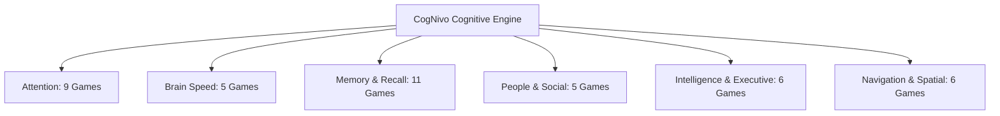
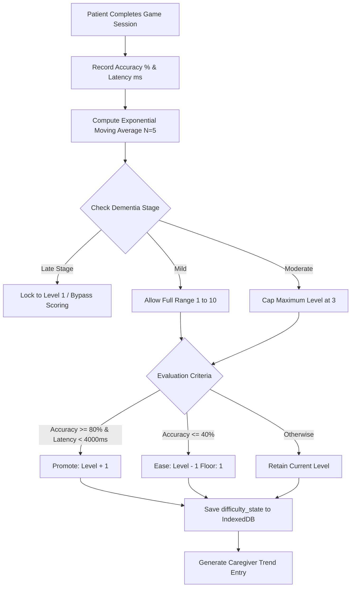
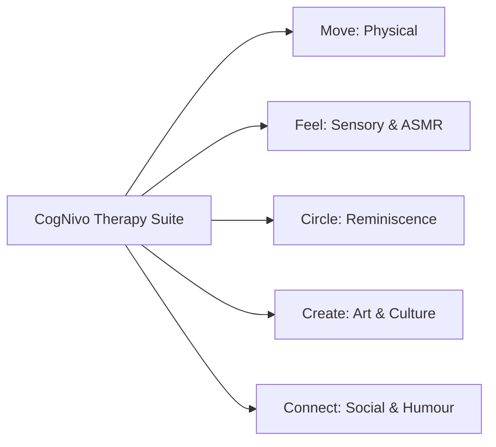
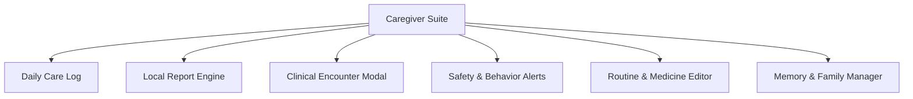

# CogNivo — Master Cognitive Gaming & Dementia Therapy Platform
## Complete Clinical, Technical, and Functional Documentation

---

### Executive Overview & Document Purpose
This document serves as the **definitive, exhaustive reference manual** for **CogNivo** (formerly CogNivo v2) — an offline-first, caregiver-supported cognitive stimulation, therapeutic memory assistance, and daily health tracking platform specifically engineered for elderly individuals experiencing Mild Cognitive Impairment (MCI) and mild-to-moderate dementia (Alzheimer’s disease, vascular dementia, Lewy body dementia, and frontotemporal disorders), with a dedicated comfort mode for late-stage support.

If you share this document with a neurologist, geriatrician, clinical psychologist, software architect, caregiver, health system partner, or investor, it provides an uncompromising, granular explanation of **every single game, clinical domain, adaptive engine, UX rule, therapeutic module, and caregiver tool** contained within the CogNivo ecosystem.

---

## 1. Clinical Rationale & Neurological Foundations

### 1.1 The Dementia Care Gap
Dementia affects over 57 million people globally, with an estimated 10 million new diagnoses each year. Traditional computerized cognitive training ("brain games") fail dementia patients for three critical reasons:
1. **Hostile Interaction Models**: Fast countdown timers, competitive score penalties, complex drag-and-drop gestures, small touch targets, and harsh failure buzzers provoke catastrophic emotional reactions ("agitation" and "sundowning").
2. **Decontextualized Abstract Tasks**: Abstract geometric puzzles lack personal emotional resonance and do not translate into activities of daily living (ADLs).
3. **Caregiver Exclusion & Cloud Fragility**: Most apps treat the patient as an isolated gamer on high-speed internet, ignoring that 90% of eldercare is delivered by stressed family members in areas with variable connectivity and acute privacy concerns regarding medical photos and health logs.

### 1.2 Core Scientific Pillars of CogNivo
* **Neuroplasticity & Cognitive Reserve**: Targeted sensory, attentional, and working-memory exercises maintain existing synaptic connections and foster compensatory neural pathways.
* **Useful Field of View (UFOV®) & Attentional Breadth**: Preserving peripheral visual processing and divided attention directly reduces fall risk, improves pedestrian/vehicle navigation safety, and preserves independence.
* **Ribot’s Law of Retrograde Amnesia**: Older, emotionally consolidated memories (childhood events, traditional songs, family roots) persist longer than recent memories. CogNivo anchors cognitive tasks to preserved autobiographical pathways.
* **Errorless Learning**: Cognitive failure feedback is clinically counterproductive in progressive neurodegeneration. CogNivo eliminates "failure states." Incomplete actions receive gentle pauses, supportive vocal re-prompts, or collaborative assistance ("Let's try that together").
* **Chronobiology & Circadian Priming**: Cognitive faculties fluctuate predictably throughout the day. Cortical alertness peaks in the morning, procedural motor fluency peaks at midday, and neuropsychiatric vulnerability ("sundowning") peaks in the late afternoon. CogNivo primes activities to these biological rhythms.

---

## 2. Interaction Design & Human Factors (15 Golden Rules)

Every screen in CogNivo is strictly governed by 15 ergonomic and psychological rules designed for impaired motor and cognitive faculties:

| # | Ergonomic Principle | Technical Implementation |
|---|---|---|
| **1** | **No Drag Gestures** | Strictly tap-to-select, then tap-to-place. No drag-and-drop is permitted in Patient Mode. |
| **2** | **Massive Touch Targets** | Minimum target size is **64 × 64 px**, separated by at least 16px of buffer space. |
| **3** | **Large Typography** | Minimum **22px** for patient body text; high contrast ratios (WCAG AAA compliant). |
| **4** | **Dual Voice Guidance (TTS)** | Web Speech API (`en-IN`, `ml-IN`, `hi-IN`) auto-speaks instructions on load with replay speaker icon. |
| **5** | **Zero Time Pressure** | Default timers are disabled or set to generous ceilings. Response windows never tighten prematurely. |
| **6** | **Errorless Feedback** | No red "X" icons, buzzer sound effects, or loss penalties. Incorrect taps trigger soft chimes and gentle re-centering. |
| **7** | **Persistent Assistance** | Always-visible Help icon. Two taps within 10 seconds triggers a gentle "Call Caregiver" alert. |
| **8** | **Zero Required Typing** | Every patient interaction is 100% voice or single-tap. Keyboard inputs are restricted to Caregiver Mode. |
| **9** | **2-Tap Navigation Depth** | Any activity can be reached in at most 2 taps from the Patient Home screen. |
| **10** | **Cognitive Fatigue Shield** | Soft voice break suggestion is triggered automatically after 12 minutes of continuous engagement. |
| **11** | **Co-Play Collaboration** | Every game features a "Play Together" toggle that adjusts thresholds for collaborative patient-caregiver play. |
| **12** | **Patient Autonomy** | The patient chooses their path through 4 large visual pillars: **Think**, **Move**, **Feel**, **Create**. |
| **13** | **Process Over Outcome** | Patient completion screens celebrate participation ("Wonderful time together!"), never displaying numeric scores. |
| **14** | **Calm Visual Environment** | Zero flashing banners, no auto-playing jarring sounds, and full respect for `prefers-reduced-motion`. |
| **15** | **Dignified Communication** | Warm, respectful tone. Never condescending, childish, or judgmental. |

---

## 3. The 42-Game Cognitive Stimulation Suite

CogNivo contains **42 specialized interactive cognitive games** organized across **7 distinct cognitive domains**. Each game reports session telemetry to the adaptive engine and session database.



---

### DOMAIN 1: ATTENTION & INHIBITORY CONTROL

#### 1. Track the Fish (`track-the-fish`)
* **Neurological Mechanism**: Divided visual attention, Multiple Object Tracking (MOT), parietal-frontal attentional network.
* **Real-World Translation**: Navigating a busy market, keeping track of grandchildren in a room, tracking vehicles while crossing the road.
* **Gameplay & Rules**: The patient is shown 2 to 4 target sea creatures (clownfish, glowing pufferfish) in a calm ocean backdrop. Once identified, several identical distractor fish join the scene. All creatures swim, drift, and cross paths for 8–15 seconds. When the fish pause, the patient taps the original targets.
* **Adaptive Parameters (Levels 1–10)**:
  * *Level 1*: 2 targets, 2 distractors, slow speed, high contrast.
  * *Levels 5–7*: 3–4 targets, 5 distractors, medium speed, moderate ocean current effects.
  * *Levels 8–10*: 4 targets, 7 distractors, variable swim speeds, subtle visual camouflage.
* **Errorless Support**: If an incorrect fish is tapped, it gently fades to translucent grey while the correct fish emit a subtle warm glow.

#### 2. Car & Sign (`car-and-sign`)
* **Neurological Mechanism**: Useful Field of View (UFOV® Mode II/III), divided attention between foveal center and peripheral field.
* **Real-World Translation**: Driving safety, detecting hazards from the corner of the eye, noticing steps or curbs while looking straight ahead.
* **Gameplay & Rules**: A vehicle (car, van, scooter) flashes in the dead-center of the screen for 250ms–1500ms. Simultaneously, a road landmark sign appears at one of 8 radial peripheral positions. The patient is asked:
  1. *Central Task*: "Which vehicle did you see in the center?" (Pick from 2 choices).
  2. *Peripheral Task*: "Where was the road sign located?" (Tap the radial direction).
* **Adaptive Parameters**: Presentation exposure starts at 1500ms and shortens to 350ms as rolling accuracy exceeds 80%. Peripheral radius expands outward toward display boundaries.

#### 3. Shape Sorter (`shape-sorter`)
* **Neurological Mechanism**: Selective attention, multi-feature filtering, Stroop-like feature inhibition.
* **Real-World Translation**: Finding the right medicine tablet among bottles of varying colors and shapes.
* **Gameplay & Rules**: Pairs of geometric shapes appear (circles, diamonds, triangles, stars) with differing colors (emerald, amber, violet) and fills (solid, striped, outline). A top banner states the matching rule (e.g., *"Match on Color only"*). The patient indicates whether the pair satisfies the rule.
* **Adaptive Parameters**: Single dimension matching at lower levels; dual-attribute conjunctions (e.g., *"Same Shape but Different Fill"*) at higher levels.

#### 4. Hear & See (`hear-and-see`)
* **Neurological Mechanism**: Cross-modal integration (auditory-visual binding), selective attentional filtering.
* **Real-World Translation**: Understanding conversation in the presence of visual background distractions (e.g., family gatherings with television on).
* **Gameplay & Rules**: An auditory letter/phoneme sound is spoken via TTS (e.g., *"B"* or *"DA"*). On screen, three letters are displayed in a row. The patient must verify if the spoken sound matches the **central** letter, actively ignoring the flanking letters.
* **Adaptive Parameters**: Acoustic similarity tightens (B vs D vs P); flanking distractor letters share higher visual overlap.

#### 5. Hold Your Tap (`hold-your-tap`)
* **Neurological Mechanism**: Inhibitory control, motor impulse suppression (Go/No-Go paradigm), prefrontal cortex vigilance.
* **Real-World Translation**: Preventing hasty actions, pausing before stepping on uneven surfaces, stopping reaching for hot utensils.
* **Gameplay & Rules**: Objects appear in a steady sequence. The patient taps rapidly for standard items ("Go" targets: flowers, fruits). When a designated "Freeze" target appears (red traffic sign, thorny cactus), the patient must inhibit tapping.
* **Adaptive Parameters**: Inter-stimulus interval contracts from 2000ms down to 800ms; target presentation probability shifts dynamically.

#### 6. Spot the Difference (`spot-difference`)
* **Neurological Mechanism**: Visual scanning, systematic spatial comparison, working visual buffer.
* **Gameplay & Rules**: Two side-by-side peaceful scenes (traditional house, floral veranda, dining room). 3 to 5 subtle differences exist (missing teacup, rearranged flower vase). Patient taps differences directly on either side. No countdown timer.

#### 7. Count & Find (`count-and-find`)
* **Neurological Mechanism**: Feature search, enumeration, focal visual fixation.
* **Gameplay & Rules**: A rich room scene is presented. A spoken prompt instructs: *"Can you find all 4 brass oil lamps?"* Patient taps items as they locate them, each producing a gentle bell chime.

#### 8. Tap When You See the Object (`tap-when`)
* **Neurological Mechanism**: Sustained vigilance, continuous performance attention (CPT).
* **Gameplay & Rules**: A steady stream of items passes through a scenic window frame. Patient gently taps whenever the designated target object appears.

#### 9. Order My Day (`time-routine`)
* **Neurological Mechanism**: Procedural temporal sequencing, daily routine orientation, executive planning.
* **Gameplay & Rules**: Shuffled visual cards representing daily routine items (Morning Tea, Blood Pressure Medicine, Bath, Lunch, Afternoon Walk, Night Sleep) appear. Patient taps each card in chronological order into numbered daily slots.

---

### DOMAIN 2: BRAIN SPEED & SENSORY DISCRIMINATION

#### 10. Bird Spotter (`bird-spotter`)
* **Neurological Mechanism**: Rapid visual saccadic acquisition, peripheral processing speed.
* **Real-World Translation**: Quickly noticing tripping hazards, sudden movements, or falling objects.
* **Gameplay & Rules**: A bird flashes briefly on a tree branch in the periphery. Immediately after, two bird pictures appear centrally. The patient identifies which bird species flashed in the branch.
* **Adaptive Parameters**: Flash duration scales from 1200ms down to 200ms; background leaves and lighting increase visual complexity.

#### 11. Spot the Twin (`spot-the-twin`)
* **Neurological Mechanism**: Rapid visual discrimination, parallel feature search.
* **Gameplay & Rules**: A grid of distinct traditional symbols flashes for a short duration. Exactly two symbols are identical. Patient spots and taps the matching pair.
* **Adaptive Parameters**: Grid scales from 2×2 up to 4×4; display exposure scales dynamically based on response speed.

#### 12. Up or Down Sound (`up-or-down-sound`)
* **Neurological Mechanism**: Auditory frequency sweep discrimination, primary auditory cortex plasticity.
* **Real-World Translation**: Discerning emotional inflections in speech, hearing warning sirens or phone ringtones clearly.
* **Gameplay & Rules**: The system synthesizes an acoustic frequency sweep: either rising in pitch (ascending sweep) or falling in pitch (descending sweep). The patient taps the **Up Arrow** or **Down Arrow**.
* **Adaptive Parameters**: Sweep duration shortens from 400ms to 60ms; pitch interval narrows from full octaves to quarter-tones.

#### 13. Stripe Direction (`stripe-direction`)
* **Neurological Mechanism**: Optic flow processing, visual motion velocity detection, magnocellular pathway.
* **Gameplay & Rules**: Concentric circular stripes expand outward or contract inward. The patient indicates whether the pattern moves *Outward* or *Inward*.

#### 14. Sound Twins (`sound-twins`)
* **Neurological Mechanism**: Phonemic temporal processing, voice-onset time (VOT) discrimination.
* **Real-World Translation**: Distinguishing similar-sounding words in noisy environments ("cap" vs "gap", "bad" vs "dad").
* **Gameplay & Rules**: Minimal spoken syllable pairs play through the speaker. Patient taps the matching written sound tile.

---

### DOMAIN 3: MEMORY & SHORT-TERM RECALL

#### 15. What's New? (`whats-new`)
* **Neurological Mechanism**: Visual scene memory, change detection, parahippocampal place processing.
* **Gameplay & Rules**: A cozy living room scene with 4 to 8 objects is studied. The screen gently dims and reopens with **one brand-new item** placed into the room. The patient taps the newly added item.

#### 16. Sound Pairs (`sound-pairs`)
* **Neurological Mechanism**: Auditory working memory, phonological loop, paired-associate memory.
* **Gameplay & Rules**: Auditory card-matching game. Patient taps speaker tiles to hear distinctive nature sounds, bells, or spoken words, flipping pairs to match identical auditory cues.

#### 17. Echo Syllables (`echo-syllables`)
* **Neurological Mechanism**: Phonological sequence span, working memory holding buffer.
* **Gameplay & Rules**: Patient listens to a sequence of spoken syllables (e.g., *"KA – NA – VA"*). They then tap the corresponding syllable cards in the exact order spoken.

#### 18. Errand Runner (`errand-runner`)
* **Neurological Mechanism**: Delayed instructional memory, multi-step procedural task adherence.
* **Real-World Translation**: Remembering multi-part instructions from doctors or family members.
* **Gameplay & Rules**: Caregiver TTS voice speaks an errand list: *"First pick up the mangoes, then get the milk, and finally find the postal envelope."* The patient moves through a virtual shop tapping items in the required order.

#### 19. Find the Odd One (`find-the-odd-one` / `mind-eye`)
* **Neurological Mechanism**: Semantic category memory, visual feature comparison.
* **Gameplay & Rules**: Four images appear; three share a category (e.g., three vegetables, one brass utensil). Patient taps the item that does not belong.

#### 20. Listen Closely (`listen-closely`)
* **Neurological Mechanism**: Auditory target filtering, acoustic memory matching.
* **Gameplay & Rules**: Patient is introduced to a target chime or animal sound. A continuous soundscape plays. Whenever the target sound occurs within the soundscape, the patient taps the screen.

#### 21. Beat Echo (`beat-echo`)
* **Neurological Mechanism**: Rhythmic working memory, auditory-motor synchronization, cerebellar timing.
* **Gameplay & Rules**: A traditional rhythm (Chenda drum or Tabla beat) plays with glowing pulse rings. Patient taps a responsive drum pad to repeat the rhythm.

#### 22. Memory Match (`memory-match`)
* **Neurological Mechanism**: Associative visual memory, spatial tile recall.
* **Gameplay & Rules**: Classic card flip matching using high-contrast traditional icons, flowers, household items, or family member portraits.

#### 23. What Went Missing? (`what-went-missing`)
* **Neurological Mechanism**: Short-term visual recall, object permanence.
* **Gameplay & Rules**: 4 to 6 items are displayed on a tray for 6 seconds. One item disappears behind a sparkle shroud. Patient taps which item went missing from a choice tray.

#### 24. Shopping List Challenge (`shopping-list`)
* **Neurological Mechanism**: Real-world semantic retention, list recall.
* **Gameplay & Rules**: Patient studies a handwritten shopping note (Milk, Coffee, Bread, Cardamom). At the market screen, they tap the remembered items from shelf displays.

#### 25. Remember the Order (`remember-order`)
* **Neurological Mechanism**: Serial order working memory, visual working memory span.
* **Gameplay & Rules**: A sequence of colored shapes or lamps lights up in sequence. Patient replicates the sequential order.

---

### DOMAIN 4: PEOPLE SKILLS & SOCIAL COGNITION

#### 26. Story Keeper (`story-keeper`)
* **Neurological Mechanism**: Episodic narrative memory, social context processing, verbal comprehension.
* **Real-World Translation**: Following conversations with visitors, retaining family news, feeling connected to family stories.
* **Gameplay & Rules**: A warm 2-minute illustrated story is read aloud with high-contrast text. Simple comprehension cards follow (e.g., *"Who brought the sweets to the harvest feast?"*).

#### 27. Who Was That? (`who-was-that`)
* **Neurological Mechanism**: Fusiform face area (FFA) activation, short-term facial encoding.
* **Gameplay & Rules**: A portrait of a person is shown for 4 seconds. Immediately following, 3 distinct faces are presented in a lineup. The patient taps the person seen previously.

#### 28. Mood Match (`mood-match`)
* **Neurological Mechanism**: Affective empathy, facial emotion recognition, theory of mind.
* **Real-World Translation**: Reading family members' emotional states, reducing social confusion or paranoia.
* **Gameplay & Rules**: Clear photographic portraits of diverse individuals expressing happiness, calm, surprise, thoughtful concern, or gentle sadness appear. Patient selects the matching emotion label or emoji.

#### 29. Name the Neighbour (`name-the-neighbour`)
* **Neurological Mechanism**: Cross-modal association, face-name-fact binding.
* **Gameplay & Rules**: Patient meets virtual community members (e.g., *"This is Sunita. She loves tending to jasmine flowers and has two grandchildren."*). Later, the patient is asked to match Sunita’s portrait with her name or favorite pastime.

#### 30. Familiar Faces (`familiar-faces` / `who-is-this`)
* **Neurological Mechanism**: Autobiographical prosopagnosia compensation, emotional face grounding.
* **Gameplay & Rules**: Powered directly by the caregiver's uploaded family gallery. Displays high-resolution photos of children, spouses, siblings, and grandchildren with large buttons stating their names and relationships (e.g., *"Daughter Deepa"*). Tapping plays an authentic audio voice note from that relative.

---

### DOMAIN 5: INTELLIGENCE & EXECUTIVE FLEXIBILITY

#### 31. Rule Switch (`rule-switch`)
* **Neurological Mechanism**: Task set-shifting, executive cognitive flexibility, dorsolateral prefrontal cortex function.
* **Real-World Translation**: Adapting when plans change, switching between cooking tasks, managing multiple steps without agitation.
* **Gameplay & Rules**: A top indicator dynamically alternates between two rules:
  * *Blue Rule (Digits)*: "Select the HIGHER number" (e.g., 7 vs 3).
  * *Amber Rule (Words)*: "Select the LOWER number" (e.g., 'nine' vs 'two').
  Patient responds quickly based on the currently active banner rule.

#### 32. Card Back (Visual N-Back) (`card-back`)
* **Neurological Mechanism**: Continuous working memory updating, 1-back / 2-back visual buffer maintenance.
* **Gameplay & Rules**: Cards are displayed one by one. The patient must answer: *"Does this card match the card shown 1 turn ago (or 2 turns ago)?"*

#### 33. Circle Numbers (`circle-numbers`)
* **Neurological Mechanism**: Psychomotor trail making, reverse digit span, spatial sequencing.
* **Gameplay & Rules**: Floating circular numbered bubbles drift gently.
  * *Mode 1 (Forward)*: Tap 1 → 2 → 3 → 4...
  * *Mode 2 (Reverse)*: Tap in countdown order from highest to lowest.

#### 34. Card Call (Auditory N-Back) (`card-call`)
* **Neurological Mechanism**: Auditory working memory updating, phonological buffer manipulation.
* **Gameplay & Rules**: A gentle voice speaks card identities (e.g., *"Ace of Hearts... Seven of Bells... Seven of Bells"*). Patient presses a large "MATCH" button whenever the spoken card matches the one called N turns prior.

#### 35. Sort It Out (`sort-it-out`)
* **Neurological Mechanism**: Conceptual categorization, executive sorting, semantic association.
* **Gameplay & Rules**: Items on a table (tools, fruits, clothing, kitchen utensils) must be placed into respective labeled baskets by tapping the item and then tapping the basket.

#### 36. Name That Object (`name-that-object`)
* **Neurological Mechanism**: Semantic retrieval, confrontation naming, anomia mitigation.
* **Gameplay & Rules**: Crisp photos of everyday household objects appear with 2 to 4 large word choices in the patient's preferred language.

---

### DOMAIN 6: NAVIGATION & SPATIAL ORIENTATION

#### 37. Flip or Turn (`flip-or-turn`)
* **Neurological Mechanism**: Mental rotation, visuospatial 2D/3D transformation, parietal lobe manipulation.
* **Real-World Translation**: Finding items in rearranged cupboards, reading house layouts, recognizing objects from unfamiliar angles.
* **Gameplay & Rules**: Two shapes are displayed side by side. One is rotated. Patient determines whether the second shape is merely **Rotated** (Turned) or whether it has been **Mirrored** (Flipped).

#### 38. Grid Twist (`grid-twist`)
* **Neurological Mechanism**: Spatial transformation memory, mental coordinate updating.
* **Gameplay & Rules**: 2 to 3 landmarks sit within a 3×3 grid. The grid is briefly hidden and rotated 90° clockwise. The patient taps where the landmarks are now located.

#### 39. Train Compass (`train-compass`)
* **Neurological Mechanism**: Wayfinding, cardinal direction integration, route memory.
* **Gameplay & Rules**: Map of a train line. Auditory instructions guide the patient: *"Departing Central Station going North. At junction two, turn East."* Patient uses an on-screen compass to select the arrival station.

#### 40. Road Ahead (`road-ahead`)
* **Neurological Mechanism**: Dynamic optic flow perception, motion parallax filtering, hazard detection.
* **Gameplay & Rules**: First-person perspective moving forward along a quiet road in varied conditions (day, rain, dusk). Patient taps approaching vehicles matching a target silhouette while ignoring peripheral roadside distractors.

#### 41. Rabbit Reach Carrot (`rabbit-carrot`)
* **Neurological Mechanism**: Spatial path planning, forward obstacle avoidance, spatial problem-solving.
* **Gameplay & Rules**: A garden grid with vegetable fences and stone obstacles. Patient taps arrows or waypoints to safely guide a rabbit to a golden carrot without hitting barriers.

#### 42. Jigsaw Puzzles (`jigsaw-puzzle`)
* **Neurological Mechanism**: Visuospatial assembly, part-whole cognitive synthesis.
* **Gameplay & Rules**: 4, 9, 16, or 25 piece puzzles featuring family photos, tea plantations, temple architecture, or nature landscapes. Strictly tap-to-select and tap-to-place (zero dragging). Pieces snap into place with satisfying tactile and audio confirmation.

---

## 4. The Heuristic Adaptive Difficulty Engine

Rather than relying on opaque cloud neural networks that raise privacy concerns and fail without internet connectivity, CogNivo utilizes an **auditable, deterministic heuristic difficulty engine** (`difficultyEngine.ts` and `adaptiveGameEngine.ts`).



### 4.1 Mathematical Formulation
For each activity, performance is tracked across a rolling window of the last $N = 5$ attempts using an exponential moving average (EMA):

$$\alpha = \frac{1}{N} = 0.20$$
$$\text{RollingAcc}_t = \text{RollingAcc}_{t-1} \cdot (1 - \alpha) + \text{Acc}_t \cdot \alpha$$
$$\text{RollingLatency}_t = \text{RollingLatency}_{t-1} \cdot (1 - \alpha) + \text{Latency}_t \cdot \alpha$$

### 4.2 Stage Safety Constraints
* **Mild Cognitive Stage**: Full scale from Level 1 through Level 10.
* **Moderate Cognitive Stage**: Hard-capped at **Level 3**. Prevents the patient from reaching task complexities that induce confusion or stress.
* **Late / Comfort Stage**: All numeric scoring, accuracy gates, and level ladders are **completely disabled**. Automatically falls back to passive sensory, musical, and comfort experiences.

### 4.3 Mood-Aware Modulation
If the patient logs a mood of `sad` or `agitated` prior to playing, the adaptive engine automatically **reduces the starting difficulty level by 1** and the recommender surfaces calming music and familiar photo activities.

---

## 5. Circadian Recommender & Priming Engine

Human cognitive faculties fluctuate according to neuroendocrine and circadian rhythms. CogNivo’s chronobiological engine (`circadianEngine.ts`) divides the day into four biological windows, automatically restructuring the Patient Home recommendation card:

```
06:00 - 12:00 | MORNING FOCUS WINDOW
├── Target: Cortical Alertness & Episodic Retrieval
└── Priority: Familiar Faces, Name That Object, Memory Match, Shopping List

12:00 - 16:00 | MIDDAY PROCEDURAL WINDOW
├── Target: Motor Coordination & Daily Sequencing
└── Priority: Seated Chair Exercises, Jigsaw Puzzles, Order My Day, Sort It Out

16:00 - 22:00 | EVENING PARASYMPATHETIC WINDOW (Sundowning Defense)
├── Target: Sensory Grounding & Anxiety Reduction
└── Priority: Relax & Unwind, ASMR Soundscapes, Music Corner, Nature Garden

22:00 - 06:00 | NIGHTTIME COMFORT WINDOW
├── Target: Sleep Induction & Melatonin Support
└── Priority: Dim Ambient Lighting, River/Rain Soundscapes, Zero Stimulating Tasks
```

---

## 6. The 5 Therapeutic Non-Gaming Pillars

CogNivo extends far beyond cognitive training, offering comprehensive non-pharmacological dementia therapies directly in the app.



### Pillar I: Move (Physical & Motor Coordination)
* **Seated Exercises**: Rhythmic chair marching, cushion passes, toe taps, arm raises with gentle finger wiggles, assisted sit-to-stand.
* **Balance & Stability Moves**: Single-leg stance, rock-the-boat sway, hip kicks. Every balance session begins with a voice-read safety confirmation requiring a caregiver to be present.
* **Gentle Yoga & Tai Chi**: 5-minute breathing flows with expanding circular visual guides to regulate autonomic breathing.

### Pillar II: Feel (Sensory Stimulation & Relaxation)
* **Interactive Sensory Box**: Calming touchscreen tactile sand box with feather drifts, rippling water rings, stress-ball squash animations, floating fireflies, and haptic vibration feedback (`navigator.vibrate`).
* **Sound Library & Dual Mixer**: Allows simultaneous blending of two audio layers (e.g., *Temple Chimes* at 40% mixed with *Monsoon Rain* at 70%).
* **Ambient Light Therapy**: Synchronizes soothing fullscreen chromatic glows (warm amber, twilight indigo, soft rose) with sleep timers.

### Pillar III: Our Circle (Reminiscence & Biographical Memory)
* **Cosy Family Tree**: Interactive visual family tree organizing children, spouses, siblings, and grandchildren with audio notes and relationship descriptions.
* **Life Timeline**: Visual chronicle of major personal milestones (Wedding day, First house, Career moments, Grandchildren births).
* **Familiar Places**: Virtual visits to childhood hometowns, shrines, and favorite gardens.
* **Music Memory Lane**: Curated era-specific playlists (1950s–1980s film songs, classical ragas, devotional music) linked to lyric sing-alongs.

### Pillar IV: Create (Creative Expression & Cultural Arts)
* **Art Studio & Tap-to-Stamp**: Big-brush painting canvas with high-contrast colors and shape stamps for patients with fine-motor tremors.
* **Traditional Coloring Book**: One-tap region coloring for cultural patterns: Kolam/Rangoli, Mandalas, Temple Elephants, and Houseboats.
* **Seasonal Traditions**: Dynamic calendar-based activities (Onam Pookalam flower carpets, Diwali Diya decorating, Vishu Kani arrangements).

### Pillar V: Connect (Social & Intergenerational Bonding)
* **Grandchild Mode**: Special 2-player cooperative layout designed for an elderly patient and a young grandchild to play Memory Match or Jigsaw together.
* **Laugh Corner**: Wholesome regional jokes, funny animal bloopers, and family anecdotes with a "That made me smile" heart button.
* **Quick Family Calls**: Large photo tiles for family members triggering direct WhatsApp or telephone calls.

---

## 7. Caregiver Dashboard & Clinical Intelligence

Caregiver Mode is protected behind a secure **PIN Gate**, providing family caregivers and visiting nurses with clinical-grade tools.



### 7.1 Daily Care Log
Tracks critical Activities of Daily Living (ADLs) in single taps:
* **Nutrition & Hydration**: Meal completion percentage, water glass count.
* **Sleep Quality**: Total hours slept, nighttime restlessness, nocturnal wandering flags.
* **Continence & Toileting**: Assisted visits, accidents, fluid intake balance.
* **Mood & Behavioral State**: Calm, cheerful, anxious, agitated, sundowning, or withdrawn.

### 7.2 Local Clinical Report Generator
Generates comprehensive clinical summaries client-side without sending data to third-party servers:
* **30-Day Domain Trajectories**: Longitudinal trend lines across Attention, Memory, Brain Speed, Executive Function, and Spatial Orientation.
* **Session Adherence**: Total active minutes, completion rate vs. abandonment rate.
* **Printable Neurologist Summary**: A standardized, one-page clinical briefing sheet formatted specifically for geriatric consultations.

### 7.3 Automated Safety Alerts
* **Inactivity Alert**: Triggered if no cognitive or care interactions are logged for > 48 hours.
* **Cognitive Drop Flag**: Automatically alerts the caregiver if rolling accuracy declines by > 20% week-over-week.
* **Medication Adherence Alert**: Notifies caregiver of missed scheduled doses after a 30-minute grace window.
* **Emergency Help Signal**: Logs immediate timestamps when the patient taps the Help button twice within 10 seconds.

---

## 8. Technical Architecture & Offline-First Implementation

CogNivo is engineered as an **Offline-First Progressive Web Application (PWA)** built with modern web technologies:

```
┌────────────────────────────────────────────────────────┐
│                   CogNivo Client PWA                   │
├──────────────────────────┬─────────────────────────────┤
│   Patient Interface      │     Caregiver Dashboard     │
│   (Tap-Only, 64px, TTS)  │     (PIN Gated, Analytics)  │
├──────────────────────────┴─────────────────────────────┤
│         Reactive State & Business Logic Layer          │
│  Adaptive Engine │ Circadian Engine │ Sound Engine    │
├────────────────────────────────────────────────────────┤
│           Client Storage: IndexedDB (Dexie.js)         │
│  patients │ sessions │ care_logs │ memories │ routines │
├────────────────────────────────────────────────────────┤
│         Browser Hardware APIs (Zero Cloud Cost)        │
│  Web Speech (TTS) │ Web Audio │ Service Worker Cache   │
└────────────────────────────────────────────────────────┘
```

### 8.1 Technology Stack
* **Frontend Core**: React 18 + TypeScript + Vite.
* **Local Database**: IndexedDB managed via **Dexie.js** (complete local persistence of sessions, family photos, voice notes, and health logs).
* **Styling & Design System**: Tailwind CSS with custom high-contrast tokens (`luminous-aura`, `obsidian-950`, `violet-400`).
* **Audio Synthesis & Soundscapes**: HTML5 Audio + Web Audio API oscillators for pure pitch sweeps (Up/Down Sound) and multi-channel ambient audio mixing.
* **Voice Synthesis**: Web Speech API (`window.speechSynthesis`) leveraging local device voices for English, Hindi, and Malayalam without API keys or recurring cloud fees.
* **Offline Service Worker**: `vite-plugin-pwa` precaching the entire application shell, local audio assets, and UI icon vectors.

---

## 9. Comprehensive Game Specification Matrix

The following reference table outlines the technical specifications for all primary games within CogNivo:

| # | Game Identifier | Display Name | Cognitive Domain | Primary Metric | Errorless Fallback Mechanism |
|---|---|---|---|---|---|
| **1** | `track-the-fish` | Track the Fish | Attention | Target Identification % | Incorrect fish fade to translucent grey; targets pulse warmly |
| **2** | `car-and-sign` | Car & Sign | Attention / UFOV | Central + Radial Acc | Sign emits radial beacon if unnoticed |
| **3** | `shape-sorter` | Shape Sorter | Attention | Rule Adherence % | Unmatched attributes highlight with soft audio cue |
| **4** | `hear-and-see` | Hear & See | Attention | Cross-Modal Binding | Distractor letters dim, center letter gently flashes |
| **5** | `hold-your-tap` | Hold Your Tap | Attention | Inhibitory Stop % | "Freeze" sign displays calming ripple animation |
| **6** | `spot-difference` | Spot the Difference | Attention | Visual Scan Acc | Hint button illuminates quadrant with subtle sparkle |
| **7** | `count-and-find` | Count & Find | Attention | Object Count % | Found objects chime; remaining items pulse gently |
| **8** | `tap-when` | Tap When You See It | Attention | Target Reaction ms | Missed target generates zero penalty |
| **9** | `time-routine` | Order My Day | Attention / Executive | Daily Sequence Acc | Misplaced cards glide smoothly back to the tray |
| **10** | `bird-spotter` | Bird Spotter | Brain Speed | Periphery Acc % | Bird perches longer if missed on initial flash |
| **11** | `spot-the-twin` | Spot the Twin | Brain Speed | Matching Speed ms | Matching twins gently pulse if scanning pauses |
| **12** | `up-or-down-sound` | Up or Down Sound | Brain Speed | Pitch Discrimination | Sweep re-plays at lower tempo with visual arrow clue |
| **13** | `stripe-direction` | Stripe Direction | Brain Speed | Motion Direction Acc | Motion speed slows gracefully until recognized |
| **14** | `sound-twins` | Sound Twins | Brain Speed | Phonemic Acc % | Both syllables play side-by-side for comparison |
| **15** | `whats-new` | What's New? | Memory | Scene Change Acc | New item sparkles gently after 10 seconds |
| **16** | `sound-pairs` | Sound Pairs | Memory | Auditory Recall Acc | Tiles remain face-up upon matching with soft chime |
| **17** | `echo-syllables` | Echo Syllables | Memory | Sequence Span Acc | Sequence re-speaks automatically upon request |
| **18** | `errand-runner` | Errand Runner | Memory | Multi-Step Acc % | Shelf items illuminate step-by-step if paused |
| **19** | `find-the-odd-one` | Find the Odd One | Memory | Category Exclusion | Odd item emits warm glow after dual attempts |
| **20** | `listen-closely` | Listen Closely | Memory | Auditory Filtering | Sound stream volume lowers, target audio is isolated |
| **21** | `beat-echo` | Beat Echo | Memory | Rhythm Timing Acc | Drum visual pad illuminates rhythm guide |
| **22** | `memory-match` | Memory Match | Memory | Pair Match Rate | Cards flip back slowly with soft audio cue |
| **23** | `what-went-missing`| What Went Missing? | Memory | Object Recall % | Missing item's outline glows faintly |
| **24** | `shopping-list` | Shopping List | Memory | Grocery Recall % | Shopping notepad can be reopened at any time |
| **25** | `remember-order` | Remember the Order | Memory | Visual Sequence Acc | Incorrect selection resets sequence gently |
| **26** | `story-keeper` | Story Keeper | People Skills | Narrative Acc % | Relevant story illustration highlights during prompt |
| **27** | `who-was-that` | Who Was That? | People Skills | Facial Acc % | Target face reappears with friendly greeting |
| **28** | `mood-match` | Mood Match | People Skills | Emotion Recognition | Supportive description of facial expression is read |
| **29** | `name-the-neighbour`| Name the Neighbour | People Skills | Face-Fact Acc % | Fact card is read aloud by friendly neighbor voice |
| **30** | `familiar-faces` | Who Is This? | People Skills | Family Association | Voice note from actual family member plays |
| **31** | `rule-switch` | Rule Switch | Intelligence | Set-Shifting Acc % | Banner changes color and speaks active rule aloud |
| **32** | `card-back` | Card Back (N-Back) | Intelligence | 1-Back / 2-Back Acc | Prior card remains faintly visible as reference guide |
| **33** | `circle-numbers` | Circle Numbers | Intelligence | Sequencing Time ms | Target number illuminates in soft gold |
| **34** | `card-call` | Card Call | Intelligence | Auditory N-Back Acc | Target card re-speaks gently |
| **35** | `sort-it-out` | Sort It Out | Intelligence | Sorting Acc % | Objects glide gently into correct bin on misplacement |
| **36** | `name-that-object` | Name That Object | Intelligence | Confrontation Naming | Spoken hint clarifies object purpose |
| **37** | `flip-or-turn` | Flip or Turn | Navigation | Mental Rotation Acc | Silhouette rotates slowly in place to show alignment |
| **38** | `grid-twist` | Grid Twist | Navigation | Coordinate Memory | Grid rotation is animated smoothly |
| **39** | `train-compass` | Train Compass | Navigation | Route Orientation | Compass needle turns toward destination |
| **40** | `road-ahead` | Road Ahead | Navigation | Hazard Detection % | Headlights illuminate target vehicle |
| **41** | `rabbit-carrot` | Rabbit Reach Carrot| Navigation | Maze Path Planning | Safe steps highlight with clover leaves |
| **42** | `jigsaw-puzzle` | Jigsaw Puzzles | Navigation / Skills | Spatial Assembly | Silhouette outline visible under puzzle frame |

---

## 10. Verification & Quality Assurance Summary

* **Accessibility Standard**: Meets and exceeds WCAG 2.1 AAA for target sizing and color contrast.
* **Offline Continuity**: 100% of game assets, audio synthesis loops, and database schemas run without network connectivity.
* **Privacy & Security**: Zero patient photos, voice notes, or health logs are uploaded to public cloud servers. All cryptographic PIN verification and data storage occur locally within the browser’s sandboxed IndexedDB.
* **Clinical Disclaimer**: CogNivo is a non-pharmacological cognitive and behavioral support platform. It is designed to complement, not replace, medical diagnosis, physician consultations, or clinical dementia treatments.

---
*Document Version: 2.4.0 • Updated for CogNivo Ecosystem • Ready for Clinical, Caregiver, and Engineering Distribution.*
